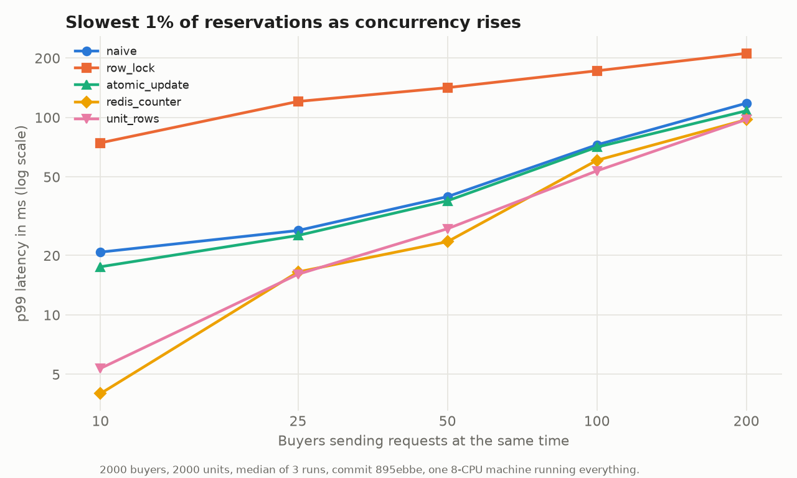

# drop

[](https://github.com/VICSTIC08/drop/actions/workflows/ci.yml)

A flash-sale backend that cannot oversell. 100 units go on sale, 1,000 buyers
click at the same moment, and exactly 100 units are sold, to 100 different
people, once each.

The same problem appears whenever many people compete for a limited thing:
concert tickets, seat selection, limited product releases, appointment slots.

This repository implements five ways to reserve stock behind one interface,
from a naive version that oversells to per-unit rows with `SKIP LOCKED`, and
measures each one for correctness, throughput and tail latency. Every number
below is generated from the raw benchmark files in `bench/results/`.

## Results

<!-- results:start -->
**Burst (the flash-sale moment)**: 100 units, 1000 buyers, 200 at a time, pool of 10 connections.

| Strategy | Sold (min–max) | Oversold (min–max) | Runs breaking a rule | Requests/s | p50 ms | p99 ms |
|---|---|---|---|---|---|---|
| `naive` | 986–996 | 886–896 | 5 of 5 | 1034 | 112.0 | 292.2 |
| `row_lock` | 100–100 | 0–0 | 0 of 5 | 2239 | 65.3 | 118.3 |
| `atomic_update` | 100–100 | 0–0 | 0 of 5 | 3811 | 38.8 | 85.4 |
| `redis_counter` | 100–100 | 0–0 | 0 of 5 | 4413 | 30.9 | 125.1 |
| `unit_rows` | 100–100 | 0–0 | 0 of 5 | 4090 | 38.1 | 103.9 |

5 runs per row, median shown. Commit `895ebbe`, Darwin 25.5.0 arm64, 8 CPUs, PostgreSQL 18.7 (Debian 18.7-1.pgdg13+5). Raw data: `bench/results/20261121-004951-895ebbe/burst.json`.

**Throughput (a unit for every buyer)**: 2000 units, 2000 buyers, 50 at a time, pool of 10 connections.

| Strategy | Sold (min–max) | Oversold (min–max) | Runs breaking a rule | Requests/s | p50 ms | p99 ms |
|---|---|---|---|---|---|---|
| `naive` | 2000–2000 | 0–0 | 5 of 5 | 1607 | 24.6 | 88.9 |
| `row_lock` | 2000–2000 | 0–0 | 0 of 5 | 1529 | 27.3 | 117.1 |
| `atomic_update` | 2000–2000 | 0–0 | 0 of 5 | 1978 | 23.7 | 40.6 |
| `redis_counter` | 2000–2000 | 0–0 | 0 of 5 | 3538 | 13.3 | 25.2 |
| `unit_rows` | 2000–2000 | 0–0 | 0 of 5 | 3142 | 15.2 | 29.0 |

5 runs per row, median shown. Commit `895ebbe`, Darwin 25.5.0 arm64, 8 CPUs, PostgreSQL 18.7 (Debian 18.7-1.pgdg13+5). Raw data: `bench/results/20261121-005345-895ebbe/throughput.json`.

**Rising concurrency: 2000 units, 2000 buyers, pool of 10.** Each cell: requests/s, then p99 in ms.

| Strategy | at a time: 10 | at a time: 25 | at a time: 50 | at a time: 100 | at a time: 200 |
|---|---|---|---|---|---|
| `naive` | 1903 / 20.8 | 1991 / 26.8 | 1993 / 39.7 | 1792 / 72.7 | 1940 / 118.1 |
| `row_lock` | 1517 / 74.4 | 1715 / 120.6 | 1687 / 141.6 | 1386 / 172.4 | 1633 / 211.3 |
| `atomic_update` | 2180 / 17.5 | 2099 / 25.3 | 2058 / 37.8 | 1968 / 70.7 | 2071 / 108.1 |
| `redis_counter` | 3819 / 4.0 | 3708 / 16.5 | 3677 / 23.5 | 3404 / 60.7 | 3303 / 97.5 |
| `unit_rows` | 3445 / 5.4 | 3304 / 16.1 | 3058 / 27.3 | 2973 / 53.7 | 2990 / 97.7 |

3 runs per row, median shown. Commit `895ebbe`, Darwin 25.5.0 arm64, 8 CPUs, PostgreSQL 18.7 (Debian 18.7-1.pgdg13+5). Raw data: `bench/results/20261121-005711-895ebbe/sweep.json`.

**Connection pool size: 100 units, 1000 buyers, 200 at a time.** Each cell: requests/s, then p99 in ms.

| Strategy | pool of 5 | pool of 10 | pool of 20 | pool of 40 |
|---|---|---|---|---|
| `row_lock` | 2232 / 133.2 | 2042 / 154.2 | 2458 / 124.8 | 2489 / 132.4 |
| `atomic_update` | 3520 / 84.6 | 3835 / 97.0 | 3745 / 97.7 | 3609 / 116.3 |
| `redis_counter` | 4722 / 71.8 | 4466 / 118.7 | 4883 / 175.7 | 5156 / 163.3 |
| `unit_rows` | 3763 / 82.1 | 4113 / 109.3 | 4050 / 155.6 | 3669 / 229.2 |

3 runs per row, median shown. Commit `895ebbe`, Darwin 25.5.0 arm64, 8 CPUs, PostgreSQL 18.7 (Debian 18.7-1.pgdg13+5). Raw data: `bench/results/20261121-010047-895ebbe/pool.json`.
<!-- results:end -->



### What the numbers show

- **The naive strategy oversold in every run.** With 100 units and 1,000 buyers
  it sold 986 to 996 units, in 5 of 5 runs. The four safe strategies sold
  exactly 100 in 5 of 5 runs each.
- **A naive strategy can also be wrong without overselling.** In the throughput
  test, where there is a unit for every buyer, it sold the right number but
  broke the conservation rule in 5 of 5 runs: its stock counter no longer
  matched what had been sold.
- **One row per unit beat the single row lock.** `unit_rows` handled about twice
  the requests per second of `row_lock` (3,142 against 1,529) with a p99 about a
  quarter as long (29.0 ms against 117.1 ms). `row_lock` had the worst p99 at
  every concurrency level, from 74.4 ms at 10 buyers at a time to 211.3 ms at 200.
- **Keeping everything in PostgreSQL cost little against Redis.** `unit_rows`
  reached 89% of the throughput of `redis_counter` (3,142 against 3,538
  requests/s), and at 200 buyers at a time their p99 was the same within noise
  (97.7 ms and 97.5 ms). `unit_rows` gets there without writing to two systems.
- **The simplest correct strategy had the best tail in the burst.**
  `atomic_update`, one SQL statement, had the lowest burst p99 (85.4 ms).
  `redis_counter` answered the most requests per second (4,413) but its p99 was
  125.1 ms.
- **A bigger connection pool did not help, and made the tail worse.** I expected
  the Redis tail to come from requests waiting for one of 10 database
  connections. The pool test contradicts that: going from 5 to 40 connections
  left throughput roughly flat and raised p99 for `redis_counter` (71.8 ms to
  163.3 ms) and `unit_rows` (82.1 ms to 229.2 ms). One explanation consistent
  with this is that more connections mean more work competing for the same 8
  CPUs, which the load generator also shares. This test does not prove that
  cause; it has 3 runs per cell and the runs are noisy.

## The five strategies

All five implement the same `reserve(drop, buyer)` contract and pass the same
test suite when buyers arrive one at a time. They differ only in how they stop
two buyers from taking the same unit.

| Strategy | How it claims a unit | What it costs |
|---|---|---|
| `naive` | Read the stock, decide in Python, write the new number back | Two buyers can read the same number before either writes. It oversells. Kept as the control group |
| `row_lock` | The same, but the read takes a row lock (`SELECT ... FOR UPDATE`) | Correct. Every buyer queues behind one row |
| `atomic_update` | Check and subtract in one statement (`UPDATE ... WHERE available > 0`) | Correct, one round trip fewer. Still one hot row |
| `redis_counter` | An atomic Lua script in Redis decides; the hold is then saved in PostgreSQL | Fast, and sold-out buyers never reach the database. But one purchase now writes to two systems that cannot commit together |
| `unit_rows` | One row per unit; each buyer locks a different free row (`FOR UPDATE SKIP LOCKED`) | Correct and all in PostgreSQL, with no single hot row. Can say "sold out" slightly early while the last units are locked by requests that later fail |

`unit_rows` is modelled on the pattern Shopify Engineering described in May 2026
for moving inventory reservations from Redis into their SQL database. This is a
small PostgreSQL version of the idea, not a reproduction of their system.

## How correctness is judged

After every test and every benchmark run, a checker (`src/drop/verify.py`) looks
only at the final rows in the database and tests four rules. It does not know
which strategy ran.

1. **No oversell.** Live holds never exceed the units for sale.
2. **One per customer.** No buyer holds two units of the same drop. A partial
   unique index enforces this in the database itself.
3. **Conservation.** Live holds plus remaining stock equals the units for sale.
   This catches units that silently go missing.
4. **Orders match.** Every checked-out hold has exactly one order.

Two races are forced to happen every time in the test suite instead of being
left to luck:

- **The lost update.** A pause point holds two buyers after both have read
  "1 left". Both then write "0 left" and both get the unit.
- **The dual write.** The request is killed after Redis has given out a unit and
  before PostgreSQL has recorded who got it. The checker reports one missing
  unit, and `src/drop/reconcile.py` repairs the counter from PostgreSQL.

## Holds expire

A reservation is a hold with a deadline. If the buyer does not check out in
time, a background sweeper marks the hold expired and returns the unit to
stock. Several sweepers can run at once without returning a unit twice, and a
hold can be checked out or expired but never both, because both paths read the
database clock.

## Run it yourself

Requires Docker, [uv](https://docs.astral.sh/uv/), Python 3.12 and, for the
benchmarks, [k6](https://k6.io).

```
docker compose up -d
uv sync
uv run python -m drop.migrate
uv run pytest -q
```

Start the API and open the interactive docs at http://localhost:8000/docs:

```
uv run uvicorn drop.main:app --reload
```

Reproduce the benchmarks, tables and figure:

```
uv run python bench/run.py burst
uv run python bench/run.py throughput
uv run python bench/run.py sweep
uv run python bench/run.py pool
uv run python bench/table.py --readme
uv run python bench/figure.py
```

## Limits of these numbers

- The load generator, the API and both databases share one laptop, so the load
  generator competes with the system it is measuring. The numbers compare the
  strategies with each other. They say nothing about production scale.
- The API is a single Python process.
- Buyers are opaque IDs sent in a header. There are no accounts and no real
  payments; checkout marks the order paid immediately.
- Every request borrows a PostgreSQL connection, including the ones Redis turns
  away, which understates what the Redis strategy could do.

## What is next

Idempotency keys, an asynchronous payment pipeline with retries and a
dead-letter queue, tests that kill the process in the middle of checkout, a
deployment on AWS, and a fair waiting room.

## Stack

Python 3.12, FastAPI, PostgreSQL 18, Redis 8, psycopg 3 (raw SQL, no ORM),
Docker Compose, pytest, k6, GitHub Actions.

## Licence

MIT
